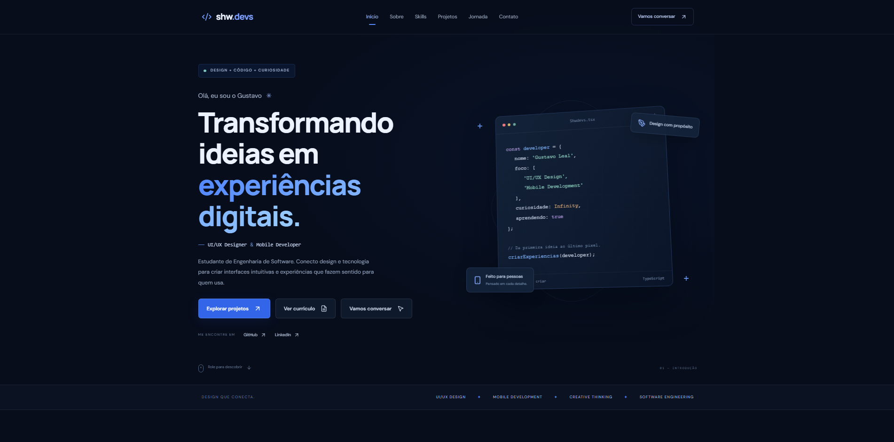

# 🖥️ ⎯ ShwDevs — Portfólio

## 🌐 Demonstração

🔗 **Acesse o portfólio:** https://shwnzzzz.github.io/Shwdevs.com/

## 👨‍💻 Sobre o projeto

O **ShwDevs** é meu portfólio pessoal, desenvolvido para apresentar minha trajetória na tecnologia, minhas habilidades, estudos e projetos.
O objetivo é mostrar como conecto design e desenvolvimento para criar interfaces intuitivas, funcionais e visualmente agradáveis, sempre buscando proporcionar boas experiências aos usuários.

## ✨ Seções do portfólio

- **Início:** apresentação pessoal e áreas de atuação.
- **Sobre:** trajetória, interesses e objetivos profissionais.
- **Skills:** ferramentas e tecnologias que fazem parte dos meus estudos.
- **Projetos:** demonstrações de conceitos e experiências digitais.
- **Jornada:** formação acadêmica e aprendizado contínuo.
- **Contato:** espaço para conexões, oportunidades e parcerias.

## 🚀 Projetos em destaque

### 🍔 | MenuGo - Cardápio Digital
Projeto de um site para restaurante, desenvolvido para apresentar pratos, preços e avaliações, proporcionando a melhor experiência digital prática e intuitiva para o usuário, pensando em acessibilidade e facilidade.

### 💜 | NexoraFinance - Controle Financeiro
Dashboard financeiro com interface moderna, tema escuro e identidade visual em tons de roxo. Desenvolvido para apresentar informações financeiras de forma organizada e facilitar o acompanhamento de receitas, despesas e metas.

### 🧡 | Apexsports - Locadora de Veículos
Projeto de um site para uma locadora de veículos, desenvolvido para apresentar opções de automóveis e oferecer uma experiência digital moderna para clientes interessados em locação.

## 🛠️ Tecnologias e ferramentas

- HTML5
- CSS3
- JavaScript
- Python
- SQL
- Git
- GitHub
- Figma

## 🎯 Objetivo

Este portfólio representa minha evolução acadêmica e profissional na Engenharia de Software. Busco aprimorar minhas habilidades em design de interfaces e desenvolvimento, transformar ideias em soluções digitais e conquistar oportunidades para crescer profissionalmente.

## 📬 Contato

Estou aberto a novas conexões, oportunidades e projetos.

- **Portfólio:** https://shwnzzzz.github.io/Shwdevs.com/
- **GitHub:** https://github.com/shwnzzzz
- **LinkedIn:** https://www.linkedin.com/in/gustavo-leal-b8183a264/

---

  Desenvolvido por <strong>Gustavo Leal</strong> — ShwDevs
   
  © 2026 — Todos os direitos reservados.

